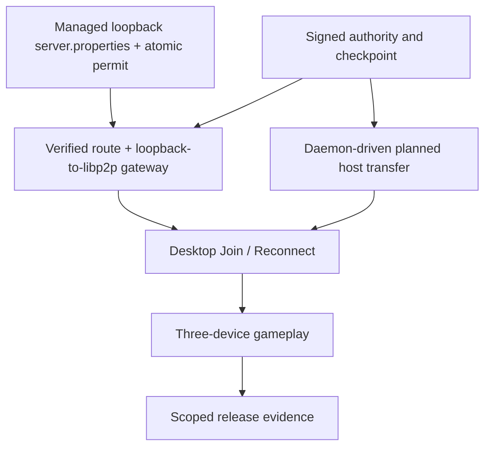

# SwarmCraft engineering audit and implementation plan

Engineering sabathon brief · 23 November 2026, UAE time (revised after independent codebase review)  
Audited baseline · SwarmCraft 0.5.1 technical preview on `main`  
Commit · `aaffac22e32547983f1fd558af6eb32c0da4917b`  
Git tree · `2ba139e6e1032fbd49e8aa0df207856a2cba68af`  
Merged integration · [PR #115](https://github.com/MousaXD/swarmcraft/pull/115)  
Companion expansion roadmap · [EXPANSION_RFC_ROADMAP.md](./EXPANSION_RFC_ROADMAP.md) (Items 56–68: horizontal simulation & ownerless/no-OP worlds)

## Start here

**Build the private-friends experience first.** The first useful milestone is a repeatable demo in which Alice creates or imports a private world, Bob joins, the app shows which save Bob has verified, Alice hands over hosting, and both reconnect to the correct world through a single stable local address. With a third voting replica online, Alice can then turn her PC off while Bob continues. The two-PC experience with no third peer needs its own hosting policy (or a lightweight headless third replica) and is the next product milestone.

SwarmCraft already ships the hard parts of a technical preview. It can persist identity, invite private members, build signed snapshots, replicate and resume world data over authenticated P2P, install a compatible Minecraft server, and start a safe successor once quorum and runtime conditions are met. The missing link is turning **“the new server is ready”** into **“the player has safely rejoined it”** via an authenticated local loopback gateway over SwarmCraft’s existing libp2p transport, alongside managed loopback `server.properties` and atomic authority permits. Windows/macOS installed GUI proof and real three-network Minecraft gameplay are also missing. [Main source](https://github.com/MousaXD/swarmcraft/tree/aaffac22e32547983f1fd558af6eb32c0da4917b) · [Implementation status](https://github.com/MousaXD/swarmcraft/blob/main/docs/IMPLEMENTATION_STATUS.md) · [Client continuity](https://github.com/MousaXD/swarmcraft/blob/main/docs/CLIENT_CONTINUITY.md)

| Priority | Outcome | Stop condition |
| --- | --- | --- |
| Sabathon P0 | A private three-peer world supports a real join, controlled handoff, crash recovery, and verified manual reconnect over a stable local loopback gateway | A reviewer can follow one recording and evidence bundle from checkpoint to actual gameplay on `127.0.0.1:<port>` without port-forwarding or raw IP handoffs |
| Sabathon P0 | A friend can understand whether it is safe to stop the host | Desktop distinguishes save present, save verified, host authorized, server ready, and game route verified |
| Release-Gate P0 | Platform and release coverage is trustworthy (post-demo release prerequisite; does not block the weekend vertical slice) | Installed Linux, Windows, Apple Silicon macOS, and supported Intel macOS have scoped evidence (using platform-appropriate automation), and release artifacts are tied to their commit |
| P1 | Small private groups can play when only one friend's PC is awake | First, a zero-Java headless third-replica profile works on a cheap VPS/Raspberry Pi under existing quorum rules; second, an optional opt-in two-PC exclusive-turn policy proves exclusive write ownership (with explicit async-handoff boundaries) |
| P1 | Private play tolerates ordinary WAN and compatibility problems | Hardened game relay quotas, optional Fabric client auto-reconnect, useful diagnostics, resumable downloads, and verified client/server runtime prep on both PCs |
| P2 | The platform supports larger groups and more worlds | Measured player and replica capacity, disk/bandwidth controls, Svelte cutover, and optional discovery and backup |
| Expansion | Horizontal multi-machine simulation and ownerless / no-OP worlds | Tracked separately in [EXPANSION_RFC_ROADMAP.md](./EXPANSION_RFC_ROADMAP.md) (Items 56–68) with separate RFC, threat-model, and GO gates |
| Research | Compare new editions and loader adapters | Separate prototypes with explicit compatibility and performance results |

### How to use this plan

Start with the [open issue ledger](#open-issue-ledger), then the [implementation backlog](#implementation-backlog) and [sabathon schedule](#sabathon-schedule). Priorities separate **Sabathon P0** (required for the playable 3-peer demo) from **Release-Gate P0** (required before broad preview/production release, not on the weekend critical path). “Built,” “partial,” “missing,” “unverified,” and “proposal” describe the evidence. A merged fix can still need issue closure or independent field testing. Items without a GitHub issue number are proposed work, and this audit has not filed or closed tickets.

## What the merged tree actually supports

| Area | Evidence on the audited tree | Missing outcome |
| --- | --- | --- |
| World lifecycle | Stable world IDs, create/import, signed invite/join, local data and persisted device identity | First-time setup across two remote real clients, role/revocation polish, and better share UX |
| Snapshots | Signed manifests and hashes, verified immutable blobs, resumable transfer, source fallback, replica acknowledgments and storage safety checks | Useful replication progress, per-peer retention and bandwidth controls, parallel source scheduling, and measured save-loss window |
| Authority | Signed leases, fencing, durable recovery ballots, stale-host rejection, and process-level recovery tests | Atomic `authority.permit` writes, full real-client failover, and a headless third-replica / two-device turn story |
| Planned transfer | Signed prepare/accept/commit/activate/observe stages, wire replication of `WireRequest::AuthorityTransfer` in `daemon.rs`, and a manual hex-token Desktop wizard | Daemon-driven automated exchange (replacing hex copy-paste) and a complete reconnect journey. An unchanged two-voter world still requires two votes after transfer |
| Sleep and wake | Durable sleep and a daemon path for wake with a surviving exact-replica quorum | Good desktop wake orchestration after everyone shuts down, and real end-to-end evidence |
| Voluntary hosting | Per-world local opt-in and heap budget, zero-budget player-only state, Tauri bridge, and rechecks on sensitive runtime paths | Whole-process resource caps, guaranteed withdrawal timing, and V2 world-policy activation |
| Player connection | Server runtime and safety status are available. The UI avoids treating a local endpoint as a verified successor route | Managed loopback `server.properties`, authenticated loopback-to-libp2p game gateway, and deliberate reconnect (followed by optional client auto-reconnect mod) |
| Network | Authenticated libp2p, discovery, QUIC, direct dialing, NAT traversal (DCUtR/AutoNAT), and relays for SwarmCraft control/replication traffic | Dedicated libp2p game-stream forwarding separated from snapshot replication, and representative home-network field results |
| Desktop | Shipping legacy HTML/JS (`apps/desktop/src`), plus a staged Svelte candidate (`apps/desktop/frontend`) mirroring all 171 DOM IDs with its own native Linux CI | Sabathon UI parity discipline, final Svelte cutover, and interactive acceptance on Windows/macOS |
| Compatibility | Managed server runtime, EULA, version checks, provider and modpack building blocks, exact hash checks | Managed `server.properties` (`online-mode`, port, bind IP, allowlist), polished compatible game-client setup, and repeatable modded cross-PC journeys |
| Discovery | Signed announcements, configured-provider search/exact resolve, and friend presence/contact primitives | Full public/friends lobby, consent and moderation, dependable discovery defaults, and join conversion |
| Release | Required CI, artifact checks, immutable preview workflow, and production signing policy | Post-merge release evidence, published preview verification, production credential and signing proof, and upgrade/rollback on installed machines |

### Findings that affect sprint scope

1. **The README, roadmap, and implementation status can disagree.** Some passages describe multi-member wake, host-transfer UI, managed runtime, or discovery as absent. Other passages and the shipped source show working subsets. The audit traced these to the daemon wake path, Tauri transfer wizard, managed runtime, and discovery commands. Rewrite the capability matrix from current code and scoped tests so developers avoid rebuilding features. [README](https://github.com/MousaXD/swarmcraft/blob/main/README.md) · [Roadmap](https://github.com/MousaXD/swarmcraft/blob/main/ROADMAP.md) · [Implementation status](https://github.com/MousaXD/swarmcraft/blob/main/docs/IMPLEMENTATION_STATUS.md)
2. **A transfer changes the host and preserves the membership rules.** The launch path observes a live permit for multi-member worlds. If the world still has two voters and Alice turns off her device, Bob cannot rely on that planned transfer to run canonically alone. The two-PC rotation you want needs either a lightweight third voting replica (recommended first) or an explicit new authority policy. [Migration runtime](https://github.com/MousaXD/swarmcraft/blob/main/crates/swarm-cli/src/migration.rs) · [Daemon lease handling](https://github.com/MousaXD/swarmcraft/blob/main/crates/swarm-cli/src/daemon.rs)
3. **A healthy SwarmCraft link does not prove the game route.** Current discovery proves useful world and peer information. Local `game_endpoint` and a persisted Ready report do not authenticate where a Minecraft client should connect after migration. The game connection needs its own route proof and authenticated transport path. [Client route RFC](https://github.com/MousaXD/swarmcraft/blob/main/docs/rfcs/minecraft-client-route.md)
4. **A public or unlisted listing does not change admission.** Creation still establishes invite-only membership in the current V1 path. Expand listing and membership in separate steps. A visible card can say how to request or enter an invite without silently enrolling a peer. [World creation](https://github.com/MousaXD/swarmcraft/blob/main/crates/swarm-cli/src/main.rs) · [Discovery](https://github.com/MousaXD/swarmcraft/blob/main/crates/swarm-cli/src/discovery.rs)
5. **The current Fabric support range is narrower than the product vision.** The shipped adapter checks Minecraft `~26.1.2`, Fabric Loader at least `0.19.3`, and Java major at least `25` when Java is checked. Provider catalog results are broader than this adapter. Because SwarmCraft manages the *server* install but not yet the player's *client* launcher (Item #40), Session 0 must include a client-profile preflight so Session 1 does not stall on version mismatches. [Runtime support contract](https://github.com/MousaXD/swarmcraft/blob/main/crates/swarm-protocol/src/runtime_support.rs)
6. **The hosting number in the UI is a Java heap budget.** `-Xmx` is real and local memory admission is conservative. It is not the whole JVM's process memory or a guarantee across multiple data roots. An unresponsive server can delay save-and-stop on withdrawal. Both limits affect what #84 can claim. [Hosting budget contract](https://github.com/MousaXD/swarmcraft/blob/main/crates/swarm-cli/HOSTING_BUDGET_CONTRACT.md)
7. **One surviving disk copy is a data-recovery statement.** A valid snapshot lets an operator recover the world bytes. Continuing writes under the original shared-world identity also needs a valid authority transition. The UI and website should state both separately. [Authority recovery](https://github.com/MousaXD/swarmcraft/blob/main/docs/AUTHORITY_RECOVERY.md)
8. **The field harness is useful but manual.** The GitHub workflow runs negative tests and can run a provisioned-host preflight. The positive field result needs installed packages, real clients, actual gameplay, reviewed evidence, and the certified three-device run. A green harness badge does not meet that condition. [Field run](https://github.com/MousaXD/swarmcraft/actions/runs/45022501088) · [Runbook](https://github.com/MousaXD/swarmcraft/tree/main/scripts/e2e/three_machine)
9. **Runtime provenance differs by component.** Managed Java requires an upstream SHA-256. The generated Fabric launcher JAR path has no independently expected digest and records a local hash after acquisition. Make that trust distinction explicit, require expected publisher integrity where supported, and decide a documented trust policy for generated launchers before production rollout. A local hash is useful for detecting later changes. It does not authenticate first acquisition. [Runtime installer](https://github.com/MousaXD/swarmcraft/blob/main/crates/swarm-cli/src/runtime_installer.rs)
10. **Concurrent runtime setup needs a shared-cache check.** The install lock is scoped to the world while managed Java is shared by Java major and platform. Cover two simultaneous installs or repairs for different worlds in an isolated test. If the shared cache can be modified concurrently, serialize publication by runtime tuple and keep a usable last-known-good copy. This is a source-review finding with a test still needed. [Runtime installer](https://github.com/MousaXD/swarmcraft/blob/main/crates/swarm-cli/src/runtime_installer.rs)
11. **`server.properties` (bind address, port, `online-mode`, allowlist, RCON) is currently unmanaged.** `migration.rs` spawns `java -Xmx{heap_mib}m -jar server.jar nogui` without writing `server.properties` or passing `--port`. Minecraft therefore defaults to `0.0.0.0:25565`, causing multi-world port collisions, exposing the server on all network interfaces outside SwarmCraft's route verification, and leaving `online-mode` / allowlist / RCON undefined for Session 1. Manage a deterministic loopback `server.properties` in P0 before exposing any game route. [Migration runtime](https://github.com/MousaXD/swarmcraft/blob/main/crates/swarm-cli/src/migration.rs)
12. **`authority.permit` writes are non-atomic in place.** `refresh_permit` calls `fs::write` directly every 1 second while `SwarmCraftMod.java` polls the file every 250 ms. On Windows (and under concurrent I/O), in-place truncation or sharing violations can produce an empty/unreadable permit and trigger false `PermitGuard` self-fencing. Switch to sibling temp-file + atomic rename (or heartbeat over the existing authenticated loopback IPC channel) before Windows field tests. [Authority permit](https://github.com/MousaXD/swarmcraft/blob/main/crates/swarm-cli/src/authority_permit.rs) · [Fabric mod](https://github.com/MousaXD/swarmcraft/blob/main/minecraft/fabric/src/main/java/dev/swarmcraft/fabric/SwarmCraftMod.java)
13. **Official Tauri WebDriver (`tauri-driver`) does not support macOS `WKWebView`.** `tauri-driver` supports Linux (`WebKitWebDriver`) and Windows (`msedgedriver`), but Apple provides no `WKWebView` WebDriver. Issue #141 must therefore use platform-specific QA adapters: `msedgedriver` on Windows and a dedicated macOS automation strategy (e.g., Accessibility/XCUITest or a QA-only IPC harness) on Apple Silicon and Intel Macs.
14. **Dual Desktop frontends create a sabathon double-maintenance hazard.** Shipping Desktop bundles legacy `apps/desktop/src`, while `apps/desktop/frontend` is a staged Svelte 5 candidate mirroring all 171 legacy DOM IDs with dedicated parity CI. Set an explicit sabathon UI rule in Session 0: either keep sabathon UI additions minimal and parity-preserving in `apps/desktop/src`, or explicitly pause Svelte parity enforcement until the post-sabathon cutover (Item #38). [Shipping Tauri config](https://github.com/MousaXD/swarmcraft/blob/main/apps/desktop/src-tauri/tauri.conf.json) · [Svelte migration](https://github.com/MousaXD/swarmcraft/blob/main/apps/desktop/SVELTE_MIGRATION.md)

## Open issue ledger

Nine GitHub issues were open when checked. The table gives the closure or completion criterion at this baseline.

| Issue | State at audit | Work before closure |
| --- | --- | --- |
| [#84 Voluntary hosting](https://github.com/MousaXD/swarmcraft/issues/84) | Partial. Local opt-in, local admission, zero budget and desktop/CLI are present. V2 activation remains unwired | Exercise direct launch, recovery, transfer and wake on real devices. Verify revocation while hosting and after restart. Agree whether a whole-process cap is required for this scope. Keep local consent and distributed policy distinct |
| [#85 Three real installations](https://github.com/MousaXD/swarmcraft/issues/85) | Open product blocker. Process recovery and managed real server launch are separately proven | Implement managed loopback `server.properties` and verified loopback-to-libp2p game routing. Run actual independent Minecraft clients, crash/transfer, restart, marker and inventory preservation, consent denial, stale host fencing, and network evidence |
| [#97 Transient artifact downloads](https://github.com/MousaXD/swarmcraft/issues/97) | Managed Java uses an upstream checksum, pinned AppImage/NSIS acquisition uses SHA-256, and 15 local CI-artifact tests passed | Finish the original outage acceptance matrix, prove verified-cache recovery on native lanes, and record which third-party download failures still block a run. Track generated runtime launcher provenance separately |
| [#120 Field withdrawal and player-only negatives](https://github.com/MousaXD/swarmcraft/issues/120) | Verifier enhancements are merged. Real-world evidence is still missing | Observe withdrawal, checkpoint/fence/stop, denied re-host, and zero-budget player joins on the real field configuration. Record who had a live JVM and who did not |
| [#135 Quinn dependency advisories](https://github.com/MousaXD/swarmcraft/issues/135) | Both merged locks use `quinn-proto 0.11.19` and `quinn-udp 0.5.16`. Normal main root and desktop audit jobs passed | Attach the version and job evidence, then close or consolidate after maintainer review |
| [#137 Quinn audit duplicate](https://github.com/MousaXD/swarmcraft/issues/137) | Overlaps #135 | Link to the canonical issue and close as duplicate after the evidence is recorded |
| [#138 Linux WebKit and managed Java coverage](https://github.com/MousaXD/swarmcraft/issues/138) | Fixes merged and candidate Linux installed-GUI and live managed-Java jobs passed | Attach exact main-run evidence that the real package launches and the fresh flow installed managed Java before closing |
| [#140 Safe preview publication](https://github.com/MousaXD/swarmcraft/issues/140) | Immutable staging and five-group verification merged. PR rehearsal passed | Inspect a real main preview, verify provenance and all assets, confirm prior preview remains usable and exercise download/rollback |
| [#141 Installed Windows/macOS GUI](https://github.com/MousaXD/swarmcraft/issues/141) | Native package builds passed. Installed WebView2 and WKWebView user journeys remain unverified | Drive real installed builds with real IPC, first boot, create/join, restart, consent and missing-sidecar negative. Use `msedgedriver` on Windows and a native macOS automation strategy (since `tauri-driver` does not support `WKWebView`). Cover Win plus supported Mac architectures and prove test hooks stay out of shipping artifacts |

### Open PRs and branch cleanup

GitHub returned 17 open PRs. The table reflects exact head ancestry and comparison of changed files at the time of the audit. A changed blob can include a superseding fix or a distinct gap. It warrants review before closure. Preserve any unique work.

| Open PRs | Observed relationship | Sprint disposition |
| --- | --- | --- |
| [#110](https://github.com/MousaXD/swarmcraft/pull/110), [#142](https://github.com/MousaXD/swarmcraft/pull/142) | Exact heads are ancestors of the audited main | Add the merge reference and close the stale records after checking any extra acceptance criteria |
| [#92](https://github.com/MousaXD/swarmcraft/pull/92), [#99](https://github.com/MousaXD/swarmcraft/pull/99), [#101](https://github.com/MousaXD/swarmcraft/pull/101), [#114](https://github.com/MousaXD/swarmcraft/pull/114) | Exact head is outside main ancestry. All files changed against their merge bases match main byte for byte | Mark content as landed and preserve approvals/limitations. Avoid a redundant merge |
| [#111](https://github.com/MousaXD/swarmcraft/pull/111) | Eleven of twelve changed files match; CI workflow has diverged | Reconcile the distinct workflow delta and existing V2 tests. Treat the foundation as inert |
| [#93](https://github.com/MousaXD/swarmcraft/pull/93), [#100](https://github.com/MousaXD/swarmcraft/pull/100) | Main has later overlapping hosting CLI/runtime/Tauri code. Some head blobs differ | Compare use cases and tests. Carry forward only protections or contracts missing from latest source |
| [#96](https://github.com/MousaXD/swarmcraft/pull/96) | Six of fourteen changed files match; main has an evolved field harness | Map unique supported checks into the current harness and preserve the remaining real execution work |
| [#77](https://github.com/MousaXD/swarmcraft/pull/77), [#119](https://github.com/MousaXD/swarmcraft/pull/119), [#124](https://github.com/MousaXD/swarmcraft/pull/124), [#129](https://github.com/MousaXD/swarmcraft/pull/129) | These safety and regression heads carry source or test differences | Compare current regression coverage and exact invariants. Keep only missing tests or fixes, with a current-source result |
| [#122](https://github.com/MousaXD/swarmcraft/pull/122), [#125](https://github.com/MousaXD/swarmcraft/pull/125) | Non-ancestor V2 signed quorum implementations. Their own changed files are not identical to main | Reconcile overlapping cryptographic contracts in one reviewed plan. Do not activate V2 during the private-world demo |
| [#91](https://github.com/MousaXD/swarmcraft/pull/91) | Independent review ledger with distinct history | Preserve the historical veto and evidence. Record a new exact-source verdict when field proof is ready |

### CI evidence on the merge tree

- The parent PR head was `9a3165c`. Git proves that it and `aaffac22` have the same tree. The PR Required Validation completed with 20 successful jobs and its optional network-soak job skipped. The installer workflow completed with 27 successful jobs, including the soak and the package/checksum verifier. Its PR-only publication skip is expected. [Required Validation](https://github.com/MousaXD/swarmcraft/actions/runs/45022501035) · [Installer verification](https://github.com/MousaXD/swarmcraft/actions/runs/45022501050)
- The installed Linux Svelte candidate test passed, and Windows, Apple Silicon macOS, and Intel macOS candidate builds passed. These jobs cover native interaction on Linux and construction on Windows/Mac. [Native Linux candidate](https://github.com/MousaXD/swarmcraft/actions/runs/45022495991) · [Windows/macOS candidate packages](https://github.com/MousaXD/swarmcraft/actions/runs/45022496027)
- The merged commit triggered its own push workflows. At inspection they were still in progress, with both RustSec audit jobs and the live managed-Java Minecraft job already green. The release list showed the older `main-latest` preview. Verify the final run and actual assets before referencing a new downloadable preview. [Main Required Validation](https://github.com/MousaXD/swarmcraft/actions/runs/45080577660) · [Main Installers](https://github.com/MousaXD/swarmcraft/actions/runs/45080577651) · [Releases](https://github.com/MousaXD/swarmcraft/releases)
- From a fresh archive of the exact merged tree, this audit reran 100 field-harness tests, 16 release publication/artifact tests, 15 CI-artifact acquisition tests, release metadata checks, and the workflow policy check. They passed. The desktop Node suite passed 110 tests and failed one runner prerequisite because ChromeDriver was absent locally. Rust was unavailable in this audit shell, so Rust evidence comes from the linked GitHub runs and earlier exact-tree checks. No new real WAN, platform or production signing evidence was generated.

## Implementation backlog

Items 1–55 cover the private-world sabathon, preview hardening, and production readiness. Long-term expansion items 56–68 (horizontal multi-machine simulation and ownerless / no-OP worlds) are tracked in [EXPANSION_RFC_ROADMAP.md](./EXPANSION_RFC_ROADMAP.md) so item numbering stays stable without blurring the weekend sabathon scope. Each row has a completion check.

### Private play and host handoff

| # | Priority and state | Work | Acceptance |
| --- | --- | --- | --- |
| 1 | Sabathon P0 · Partial | Make one private flow connect Create/Import, Invite, Join, Verify save, and Play in the shipping UI. Reuse the Rust membership and installer paths | Two fresh devices join one world by invite, without terminal steps or manual world-folder copying |
| 2 | Sabathon P0 · Missing | Define and implement an authenticated route offer and freshness verifier for the currently authorized Minecraft host | Resolver proves exact world/generation, fresh authority, membership, and runtime readiness before admitting a route. Expired, retired, conflicting, and wrong-world routes are rejected |
| 3 | Sabathon P0 · Missing | Ship a local loopback TCP gateway (`127.0.0.1:<stable-port>`) and verified **Join current host / Reconnect** action. Separate server ready from game route verified | Players add one permanent loopback address in Minecraft. On host change or fencing, the gateway closes the old stream immediately; after verified handoff, manual reconnect to the same loopback address lands only on the verified successor and sees the saved marker. Errors distinguish route, transport reachability, permission, and compatibility |
| 4 | Sabathon P0 · Partial | Automate the signed staged transfer exchange behind the existing wizard by letting `daemon.rs` advance `WireRequest::AuthorityTransfer` reactively instead of manual hex copy-paste (`transfer_commands.rs`) | Both sides persist transfer ID/phase and resume cleanly after app or `run_cli` restart without duplicate transfer. The successor sees a durable checkpoint. The source releases hosting and returns as a replica |
| 5 | Sabathon P0 · Partial | Surface Host Readiness, replica freshness, and shutdown outcome in one player flow | Stale replica, unreachable voter, missing mods, zero budget, and active safe successor produce distinct messages. Green requires fresh backend proof |
| 6 | Sabathon P0 · Partial | Make sleep/wake reachable through ordinary UI and verify the supported quorum path with real Minecraft | All peers stop safely. Original host stays off. A supported surviving majority wakes the exact saved world with one active authority |
| 7 | P1 · Missing | Add an optional first-party Fabric **client** auto-reconnect mod on top of the P0 loopback gateway | On disconnect, the gateway closes the old game stream; with explicit opt-in, the client mod starts a fresh Minecraft connection to the same loopback entry only after a new trusted route is verified. Retry is bounded and cancelable |
| 8 | P1 · Proposal (after #9) | Design an explicit two-device **Pass hosting** policy with one writable holder, explicitly specifying online-overlap vs. async-dropbox handoff requirements | Both devices can transfer the right to play without a third voter when they overlap online (or via an explicit async dropbox adapter if one is offline). Partition tests prove there is never a second writer |
| 9 | P1 · Proposal (recommended first) | Provide a supported headless zero-Java third-replica profile (`swarmcraft daemon`) for small private worlds | A small third device (Raspberry Pi, NAS, or low-cost VPS) runs and restarts without Java, acknowledges current saves, and votes under the existing quorum rules — solving both crash failover and async offline handoff with zero new consensus machinery |
| 10 | P1 · Partial | Make invite expiry, reuse, membership approval, pending state, and revocation legible. Review a recipient-bound or one-use invite option | An expired or revoked grant cannot admit a new device. A removed device cannot fetch newer private snapshots. Existing downloaded copies have clearly documented retention limits |
| 11 | P1 · Partial | Expose a clear recovery path when a sole valid copy survives but quorum is gone. Reuse export/import and add a labeled recovered-world workflow | The original bytes are preserved. A new recovered world uses a new identity unless a valid original authority transition exists. UI clearly identifies the old and new worlds |

### Connectivity and real Minecraft validation

| # | Priority and state | Work | Acceptance |
| --- | --- | --- | --- |
| 12 | Sabathon P0 · Missing | Build authenticated game-traffic transport as a dedicated libp2p stream protocol (reusing existing QUIC/TCP/Noise/DCUtR/relay) wired directly into the P0 loopback gateway (#3), isolated from `request-response` snapshot sync | Remote players complete real Minecraft login and play without manual router port-forwarding. Game streams authenticate both ends against world membership/authority, apply bounded queues/backpressure, and never starve or corrupt authority/snapshot validation |
| 13 | Sabathon P0 · Unverified | Execute the three-device field run for #85 and #120, including opt-out | Alice, Bob, and Carol play on independent networks through the loopback gateway. The original host is stopped or isolated with approved controls. The correct successor restores the marker, and the original host cannot resume stale writes |
| 14 | P1 · Partial | Finish discovery and connection diagnosis for ordinary players. Show whether directory, peer link, host proof, or Minecraft game stream failed | Per-path results are fresh and actionable. Failure has retry/copy options and no endless loading or false Ready |
| 15 | P1 · Unverified | Certify representative LAN, WAN, home NAT, CGNAT, IPv6, mobile, blocked UDP, and packet-loss scenarios | Matrix reports network class, selected control and game routes, success/failure, and reason. Any unsupported path is named accurately |
| 16 | P1 · Partial | Publish deployable discovery bootstrap, private rendezvous, and game relay configurations with documented boundaries | A new group can bring up its own compatible node, swap relays, and recover from relay outage. Relay and directory services never grant world authority |
| 17 | P1 · Proposal | Define relay connection, bandwidth, duration, auth, and resource policies before shared hosting | Fair-use and disconnect behavior are measured with multiple worlds. Invites and private route details are absent from public logs |
| 18 | P2 · Proposal | Add adaptive replication throttling so background saves do not ruin game latency | On a limited uplink, measured game responsiveness stays within a published target while the replica continues to make bounded progress |

### Hosting consent, membership, and safety

| # | Priority and state | Work | Acceptance |
| --- | --- | --- | --- |
| 19 | Sabathon P0 · Partial | Prove per-world player-only default, opt-in persistence, and withdrawal through CLI, native IPC, and live hosting; make `authority.permit` updates atomic (temp + rename or loopback IPC) | Zero-budget peer can join and replicate with no JVM. Consent stays scoped to one world and persists across restart. Every launch path rejects missing or withdrawn consent, and concurrent permit reads on Windows/POSIX never see a truncated permit file |
| 20 | Sabathon P0 · Partial | Clarify withdrawal lifecycle and handle a hung JVM without silently losing the current save | UI shows **Stopping at checkpoint** until proof of checkpoint/fence/exit, or a truthful error with recovery choices. Stale readiness and active gateway routes are cleared immediately |
| 21 | P1 · Partial | Improve process identity and coordinate a safe resource budget across data roots where supported | Local concurrency/orphan tests cover process identity, restart, and no second host when capacity or ownership is ambiguous |
| 22 | P1 · Missing | Add whole-process limits only on platforms that can enforce them. Evaluate delegated Linux cgroups, Windows Job Objects, and macOS capability separately | Measurement includes native memory and children. Unsupported enforcement is labeled heap-only. Existing Java heap and memory headroom rules stay in force |
| 23 | P1 · Partial | Reconcile V2 transcript, signed consent, voter proof, and admission work from #122/#125. Plan durable migration from V1 separately | Exact source history, signed approvals, stable and joint voter majorities, replay bounds, no legacy stale writes, interrupted migration, and rollback behavior are reviewed and tested |
| 24 | P1 · Partial | Split member, player, replica, voter, administrator, and host-candidate permissions in UI and policy | A non-hosting replica can safely vote. A player or viewer can’t become host from UI preference alone. Membership changes preserve durable quorum rules |
| 25 | P1 · Proposal | Add supported invite/device lifecycle, including contact removal, replacement devices, and recovery of a lost identity | Losing a PC has a documented repair path. A removed device cannot regain access through stale presence or an obsolete invite. Private recovery material is only exported with explicit user action |
| 26 | Sabathon P0 (baseline) / P1 (full identity mapping) · Missing | Manage deterministic `server.properties` at Fabric launch (`server-ip=127.0.0.1`, per-world loopback port, explicit `online-mode`, `enable-rcon=false`, baseline allowlist); in P1 connect private SwarmCraft membership to full Minecraft login/session allowlist policy | **P0:** Launched servers never bind `0.0.0.0:25565`, never collide across worlds on one PC, and enforce explicit `online-mode` so Mojang UUIDs/inventories survive host transfer. **P1:** Swarm membership and Minecraft game identity stay consistently enforced so unauthorized game sessions are rejected |
| 27 | P2 · Proposal | Define public/unlisted/private visibility behavior and moderation roles before public rollout | Visibility never bypasses membership. Admin actions and role changes can be reviewed, and private data does not leak to discovery |

### Snapshots, storage, and scale

| # | Priority and state | Work | Acceptance |
| --- | --- | --- | --- |
| 28 | Sabathon P0 · Partial | Show accepted checkpoint, last replica acknowledgment, size, lag, and progress since the last recoverable save | A player can tell how much progress is at risk. A locally created but unreplicated save has different status from a verified replica |
| 29 | P1 · Partial | Add backup retention, disk quota, and space recovery controls on top of current storage primitives | The newest recoverable checkpoint and in-use roots survive cleanup. Low disk space pauses with a usable remediation path |
| 30 | P1 · Partial | Finish manual checkpoint selection, verified restore, and conflict inspection UX | User can inspect/export both divergent histories, choose an explicit recovery outcome, and keep a recoverable original copy |
| 31 | P1 · Proposal | Offer an encrypted checkpoint export/import bundle for backup and deliberate transport. Treat Drive or object storage as optional transport adapters | An interrupted upload never becomes a current save. The recipient validates immutable manifest/blob hashes and signature before restore. Backup cannot grant host authority |
| 32 | P2 · Partial | Download unrelated missing blobs in parallel from multiple authorized replicas, with bounded scheduling and resume | Compare time to verified restore against source fallback. Failure or corruption from one source does not restart or invalidate safe work from others |
| 33 | P2 · Missing | Evaluate incremental region/chunk checkpoints and snapshot scheduling | Demonstrate lower bytes and shorter save window on a controlled dataset. A known full restore still works and is cross-checked |
| 34 | P2 · Research | Evaluate operation journaling and erasure coding independently | Proven improvement against an existing snapshot baseline; fault tolerance, restore complexity, and storage cost are measured before new live formats |
| 35 | P2 · Unverified | Publish capacity with separate player, voter, replica, world-size, and relay tests | Real game-server measurements report player counts, TPS, and resource ceilings. Replica count is never presented as extra simulation capacity |
| 36 | P2 · Proposal | Add background replica scheduling, quotas, bandwidth windows, and replica placement controls | A user can choose what to cache. Hot worlds retain the configured recoverability target under normal churn without overrunning disk or bandwidth |

### Desktop, runtime, and compatibility

| # | Priority and state | Work | Acceptance |
| --- | --- | --- | --- |
| 37 | Release-Gate P0 · Unverified | Implement installed Windows/macOS native GUI QA for #141 using platform-valid automation | Exercise actual WebView2 (`msedgedriver`) on Windows and native WKWebView automation (Accessibility/XCUITest or isolated QA bridge, not `tauri-driver`) on Apple Silicon & Intel macOS with real sidecars, real IPC, restart, host consent, and an intentional failure in a separate QA build |
| 38 | P1 · Partial | Decide Svelte cutover after shipping parity review (post-sabathon) | The candidate covers all legacy journeys, including private invite, host transfer, loopback reconnect, safe stop/wake, mod setup, and recovery. Installed builds and rollback prove the packaging switch |
| 39 | P1 · Partial | Simplify first run and import. Add a native folder picker when supported and show source/runtime requirements before commit | A fresh user can import a supported world, finish explicit EULA, see capacity and mod blockers, and recover an interrupted install |
| 40 | P1 · Partial | Deliver compatible game-client preparation and handoff to the chosen launcher. Preserve the user's account and settings | Matching Java/Fabric/mod set launches or is clearly directed. Existing Mojang/Microsoft sign-in and entitlement remain intact. No credentials travel through invites |
| 41 | P1 · Partial | Finish modpack dependency acquisition for each supported provider and manual-artifact fallback | A pristine target acquires allowed artifacts from their authorized source, verifies exact bytes, and shows unavailable or incompatible components. No silent redistribution |
| 42 | P2 · Partial | Add a compatibility matrix for Minecraft versions and Fabric builds. Develop and test an adapter before widening support | Every offered tuple passes a real server launch, save, restore, and game-client connection. Unsupported versions remain visible with accurate messaging or filtering |
| 43 | P2 · Proposal | Improve accessibility and everyday polish across main actions | Both supported window sizes, keyboard-only flow, screen-reader names/live state, scaling, long names and IDs, and interrupted progress pass on installed builds |
| 44 | P2 · Research | Evaluate additional loaders, Bedrock clients, and cross-play separately | Work only from a proven Fabric baseline. Each new adapter documents worlds, mods, game protocol, lifecycle limits, and cross-platform evidence |

### Discovery, privacy, and community

| # | Priority and state | Work | Acceptance |
| --- | --- | --- | --- |
| 45 | P2 · Partial | Build the normal-player world lobby on signed discovery and provider results | Public search and exact unlisted resolve have useful empty states, bounded paging, freshness display, and a separate private Join action |
| 46 | P2 · Partial | Connect friend contact/presence primitives to explicit consent, hide/offline mode, and useful invitations | Friends see only the metadata a user agreed to share. Removing a contact stops future private presence access. Offline has honest freshness |
| 47 | P2 · Proposal | Add public-world governance and abuse handling once private play is stable | Listing visibility, moderation, region/language metadata, report flow, and local filtering work without granting registry veto power over world history |
| 48 | P2 · Proposal | Add opt-in, redacted diagnostics export and a useful local history of world actions | Users can export time, commit, path class, and event summaries while excluding private invites, credentials, raw private addresses, and world data |

### Production engineering and long-term scope

| # | Priority and state | Work | Acceptance |
| --- | --- | --- | --- |
| 49 | Sabathon P0 · Partial | Reconcile open issues, PRs, and capability claims against main | Every stale ticket has a landed commit or exact residual; open acceptance blockers remain linked. README, roadmap, and install instructions agree |
| 50 | Release-Gate P0 · Partial | Verify an immutable main snapshot and rollback, then establish production release evidence | Preview retains previous assets and validates source/version/hash. Tagged release independently verifies Windows signing and Mac notarization; mobile and unsupported packages are clearly scoped out |
| 51 | P1 · Partial | Extend release resilience for download outages, executable provenance, shared runtime cache publication, and dependency health | Corrupt input fails validation. Same-runtime installs from two worlds preserve the last known-good cache. Every generated or downloaded executable has explicit provenance and verification status |
| 52 | P1 · Partial | Establish upgrade, downgrade, schema, and interrupted migration acceptance from the supported older preview | One real saved world and consent history survive upgrade and restart. Unsupported downgrade stops clearly, with verified export/rollback guidance |
| 53 | P1 · Partial | Extend crash, disk-full, retention, platform resource, and network campaigns beyond current automated gates | Published stress matrix includes repetitions, actual resource limits, last accepted checkpoint, and explicit failure causes. Saved canonical data remains recoverable |
| 54 | P2 · Proposal | Add signed update delivery and platform installation hygiene after release provenance is stable | Client verifies manifest and package signature, separates preview/stable channels, supports opt-out, and rejects an incompatible or untrusted update |
| 55 | P2 · Missing | Define production metrics, support runbooks, and per-version compatibility policy | Field team can diagnose boot, replication, lease, game connect, restore, and publication with bounded and redacted evidence |

*Long-term expansion items 56–68 (distributed horizontal simulation and ownerless / no-OP worlds) live in [EXPANSION_RFC_ROADMAP.md](./EXPANSION_RFC_ROADMAP.md).*

Sources for the backlog · [Open issues](https://github.com/MousaXD/swarmcraft/issues?q=is%3Aissue+is%3Aopen) · [Implementation status](https://github.com/MousaXD/swarmcraft/blob/main/docs/IMPLEMENTATION_STATUS.md) · [Product vision](https://github.com/MousaXD/swarmcraft/blob/main/docs/PRODUCT_VISION.md) · [Network validation](https://github.com/MousaXD/swarmcraft/blob/main/docs/NETWORK_VALIDATION.md) · [Distributed simulation research](https://github.com/MousaXD/swarmcraft/tree/main/research/distributed-simulation)

## Build the private world in this order

### 1. Make the next host reachable (loopback gateway + libp2p game stream)

Use the existing [Minecraft client route RFC](https://github.com/MousaXD/swarmcraft/blob/main/docs/rfcs/minecraft-client-route.md) as a design input, **promoting the local loopback TCP gateway directly into P0** while keeping the optional Fabric client auto-reconnect mod for P1. Building the loopback gateway over libp2p streams first avoids throwaway raw-IP UI, eliminates home-router port-forwarding, prevents Minecraft from caching stale host IPs, and keeps the Minecraft server off public network interfaces.

1. **Harden the local server boundary first.** Generate and enforce deterministic `server.properties` at Fabric launch (`server-ip=127.0.0.1`, allocated per-world loopback port, explicit `online-mode`, `enable-rcon=false`), and make `authority.permit` writes atomic (temp file + rename or loopback IPC).
2. **Publish a bounded, signed route offer in Rust.** Emit it only after authenticated Fabric readiness and an accepted generation. Bind it to world ID, compatible runtime, current authority, membership proof, fencing generation, accepted snapshot, short validity, and the authority’s authenticated libp2p peer identity.
3. **Verify freshness in the resolver before forwarding any bytes.** Obtain fresh evidence that the generation is still canonical (challenge/response over the authenticated SwarmCraft link plus quorum/authority verification). Maintain a durable generation floor. Refuse inconsistent history, missing quorum, stale identities, or unknown route state. A persisted migration report or configured `game_endpoint` alone can never satisfy this check.
4. **Forward game TCP through a dedicated loopback-to-libp2p stream gateway.** Bind a stable local address (`127.0.0.1:<world-port>`) on the player’s machine and proxy each Minecraft TCP connection over a dedicated libp2p stream protocol (reusing SwarmCraft’s QUIC/TCP/Noise/DCUtR/relay stack, isolated from `request-response` blob sync with bounded buffers and connection caps) to the verified authority’s loopback Minecraft listener. Immediately sever active game streams when the epoch changes, authority is fenced, or consent is withdrawn.
5. **Wire the gateway into Desktop Join/Reconnect and prove it with real Minecraft.** Expose the verified loopback address and distinct states (waiting for quorum, syncing save, restoring server, verifying route, ready on `127.0.0.1:<port>`) through a typed Tauri command. Clear cached routes immediately on world change or generation change. Drive a real Minecraft client through the gateway and record pre/post game state, disconnect/rejoin on the same loopback entry, authority generation, and accepted checkpoint.

### 2. Turn the transfer wizard into one safe journey

Keep the existing signed transfer record, Fabric checkpoint barrier, and `WireRequest::AuthorityTransfer` replication already wired in `daemon.rs`. Begin with the three-voter topology so this ships without a new voting policy.

1. Select a reachable recipient with verified runtime, compatible mods, current eligible consent, and surviving quorum. Display its checkpoint lag and whether a clean shutdown can follow.
2. Checkpoint and save. Advance `Prepared → Accepted → Committed → Activated → Observed` reactively inside the daemon over `WireRequest::AuthorityTransfer` (gated by local recipient consent and verified final snapshot), replacing the 5-step manual hex copy-paste loop in `transfer_commands.rs`. Revalidate authorization at the final boundary where it is used.
3. Persist the transfer identifier and phase durably in daemon/storage state so a lost response, `run_cli` timeout, or Desktop restart recovers status idempotently without duplicate transfer.
4. Stop or fence the source (and drop its active game streams) before the target accepts game traffic. Launch from the exact accepted snapshot. Use the loopback gateway to reconnect clients cleanly to the same local address.
5. Return the old host as an ordinary replica and prove it syncs forward. Show **Safe to turn off** only when the handoff has reached its durable outcome and the remaining peers can sustain the chosen policy.

### 3. Decide which two-friend experience to ship

| Design | What Alice does before logging off | What Bob can do later | Async offline gap & failure behavior |
| --- | --- | --- | --- |
| **Recommended first (Item #9):** Current quorum model with a headless zero-Java third voting replica (`swarmcraft daemon` on a Raspberry Pi, NAS, or low-cost VPS) | Sync the latest checkpoint to authorized replicas (including the lightweight replica). Complete transfer or simply stop cleanly | Use Bob's PC plus the third voting replica to form quorum. Bob pulls the latest save from the third replica even if Alice is already off, and hosts Minecraft if opted in | Solves **both** unexpected crash takeover and asynchronous offline handoff with zero new consensus protocol. If quorum or checkpoint is unavailable, stays safely blocked |
| **Optional second (Item #8):** Proposed exclusive-turn policy for exactly two PCs | Finish **Save, sync, and hand off**. Persist a relinquishment and transfer write permission to Bob | Start as the named holder after verifying the committed save, even if Alice is off, under the new reviewed policy | **Online-overlap constraint:** If Bob is already offline when Alice wants to log off, neither PC is awake to store the final save or handoff token unless paired with an external async dropbox (Item #31). If the source crashes before relinquishing, Bob waits or uses explicit assisted recovery |
| **Transport helper (Item #31):** Optional encrypted checkpoint transport | Upload a completed signed bundle. Publish its manifest only after all required encrypted data is present | Fetch and verify newer checkpoint bytes when no P2P source is reachable | Missing partial uploads remain invisible. Storage or a newer timestamp grants no host permission |

**Order of implementation** · Ship and certify the three-peer private experience first, then package **Item #9 (headless zero-Java third replica)** as the primary small-group solution because it reuses existing quorum rules and solves async offline handoffs cleanly. Only after that, review and prototype **Item #8 (two-device exclusive-turn)** on an opt-in branch — explicitly deciding up front whether it requires online overlap at handoff or pairs with an encrypted dropbox (Item #31) for offline handoff.

For the two-device policy (if pursued), write the state machine and test it before UI. A proof must identify one holder, a monotonically increasing world generation, the exact accepted checkpoint, and durable state on both sides. Define which side may recover each partial handoff. Cover disconnect before sync, restart after commit, delayed delivery, rollback of a local save, lost recipient device, duplicate transfer requests, and stale attempted resume by the old host. Decide up front whether lost-grant recovery creates a separately labeled world or requires a trusted coordination service. Preserve the default world quorum model and existing worlds.

If the desired promise is **automatic takeover after an unexplained crash**, either keep an independent third voter (Item #9) or add a separately reviewed coordination system. When both devices are still independently allowed to write, they cannot safely tell a powered-off computer from a broken link just by waiting. Choose safety, clear availability limits, and a predictable recovery action.

### 4. Validate data loss and reconnect time honestly

Record three timestamps per run · the last accepted checkpoint, interruption, and first successful post-recovery player action. Report data loss using the checkpoint and actual in-game markers, and recovery time from interruption to playable state. Compare clean handoff with a forced crash. Unsaved progress after the accepted checkpoint is a separate measure. Start with a baseline, then agree targets from observed results instead of promising a universal downtime or player count.

## Sabathon schedule

This is a session-based plan because the duration, team size, and available test hardware were unspecified. Session 2 is intentionally split into **2A (backend gateway & safety)** and **2B (transfer automation & UI)** so the highest-risk networking slice is proven end-to-end via CLI + real Minecraft before Desktop UI integration. Release-Gate P0 items (#141 Win/Mac automated GUI QA and #50 signed/notarized releases) run in parallel only if extra hands/hardware exist; they do not block the weekend vertical slice.

| Session | Primary work | Parallel work if people are available | Exit evidence |
| --- | --- | --- | --- |
| 0 · Set the baseline | Build the audited tree, provision three independent machines, verify a **Minecraft `26.1.2` + Fabric `0.19.3` + Java `25` client-launcher preflight** on each player PC, and lock the **sabathon Desktop UI rule** (legacy `apps/desktop/src` parity policy) | Reconcile stale open tickets/PRs (#110, #135, #137, #142) and verify main preview artifacts | Installed package hashes, working `26.1.2` Minecraft client profiles on test PCs, repeatable setup runbook, redacted evidence template, and verified base commit |
| 1 · First private play | Run the current private create/invite/sync/start flow from fresh profiles and record the first real blocker; land managed loopback `server.properties` (#26 P0) and atomic `authority.permit` writes (#19) | Add actionable checkpoint/freshness copy; start Windows `msedgedriver` QA harness (separate from macOS WKWebView plan) | Both players join the same world with one marker; server binds loopback-only with deterministic `online-mode` and no multi-world port collisions |
| 2A · Backend gateway & route proof | Implement the signed route offer, freshness challenge/response, durable generation floor, and **loopback-to-libp2p game stream gateway** (#2, #3 backend, #12). Prove via CLI + real Minecraft client before touching Desktop UI | Verify opt-out/zero-budget and wake gates on the new loopback server setup | Wrong generation and unavailable quorum refuse forwarding; a real Minecraft client joins `127.0.0.1:<port>` over the authenticated libp2p stream without port forwarding |
| 2B · Transfer automation & Desktop UI | Wire daemon-driven `WireRequest::AuthorityTransfer` automation (#4) with durable restart recovery, and connect the loopback gateway + **Safe to turn off** / **Join & Reconnect** status into Desktop (#3 UI, #5) | Check Desktop parity tests against `apps/desktop/src` and verify no stale routes survive world switching | One-click staged transfer completes without hex copy-paste; Desktop displays honest route/quorum/checkpoint states and clears routes immediately on generation change |
| 3 · Planned transfer | Run full three-voter planned handoff through installed packages: commit final save, fence source (dropping old gateway stream), launch successor, and manually rejoin on the exact same `127.0.0.1:<port>` entry | Test package restart and live consent withdrawal (#120) on native installations | Alice powers off cleanly after valid handoff in the three-voter setup; Bob clicks Reconnect on the same loopback entry, sees the committed marker, and zero traffic reaches the old host |
| 4 · Crash and recovery | Repeat with approved hard interruption and no prepared handoff, then bring the old host back online to prove fencing and forward sync | Execute two-voter loss, unavailable replica, relay fallback, and paused-save negative tests appropriate to the test environment | Successful cases and blocked cases each have original evidence; recorded time-to-play and last preserved save |
| 5 · Demo and handover | Walk through the supported path in one uninterrupted recording. Deliver the exact source, packages, evidence, and open gaps | Update README/Roadmap/Status capability matrix (#49) and file clean follow-up issues for remaining P1/Release-Gate work | Demo claims match observed results. The release decision still refers to the complete acceptance matrix |

### Scope choices for the event

- **Minimum demo** · Two real people join a private world through the loopback gateway and both read the same retained in-game marker after host transfer while a third voter remains reachable. Require native installed packages and verified manual reconnect on the same `127.0.0.1:<port>` address for the actual demo claim.
- **If WAN or driver setup takes longer** · Demonstrate the exact route verifier, loopback-to-libp2p gateway, and real gameplay on controlled local devices. Report which network and platform checks were blocked. Keep the three-network claim open.
- **If the main demo passes early** · Add relay-path verification, the withdrawal and all-off wake variants, and a field recording. Package the headless zero-Java third replica (Item #9) first before prototyping two-device exclusive turns (Item #8) on a separate branch.
- **After the event** · Complete Release-Gate P0 (#141 Win/Mac installed GUI QA, #50 signed/notarized releases), optional Fabric client auto-reconnect (#7), headless third replica (#9), Svelte cutover (#38), broader resource enforcement, and production rollout in independently testable increments.
- **Keep out of the first demo** · Live V2 activation, public discovery, multiple Minecraft editions, macOS WKWebView automation, horizontal distributed ticks / ownerless mode ([EXPANSION_RFC_ROADMAP.md](./EXPANSION_RFC_ROADMAP.md)), unbounded performance promises, and a mandatory cloud backend.

### Work that can run in parallel

| Workstream | Start with | Rendezvous |
| --- | --- | --- |
| Rust authority, runtime & game gateway | Managed loopback `server.properties`, atomic `authority.permit`, route contract, durable freshness, loopback-to-libp2p stream gateway | Desktop accepts only this typed contract; runtime provides authenticated readiness |
| Desktop private-world flow | Existing wizard, readiness and checkpoint displays, native command adapter (following the Session 0 parity rule) | Integrate once Session 2A proves the loopback gateway and daemon transfer state via CLI |
| Storage and reliability | Checkpoint acknowledgement, restart/resume, disk/backup risk | Handoff completion is bound to the existing signed checkpoint |
| QA and platform packaging | Fresh client `26.1.2` profiles, field rigs, in-game state and package evidence; Windows `msedgedriver` & separate macOS native QA spikes | Run against the exact integration commit after Sessions 2A–2B land |
| Release and documentation | Open issue reconciliation, artifact run, fix agreement between documents | Certify the exact shipped build only when the adjacent scope has evidence |

### Main dependencies

Windows/macOS installed acceptance (#141) and signed artifact provenance (#50) are independent **Release-Gate P0** prerequisites for broad desktop release, not blockers for the weekend sabathon vertical slice. The small-group post-demo track starts with the headless zero-Java third replica (Item #9), followed by exclusive-turn policy review (Item #8) if still needed. Neither depends on enabling V2 world-policy migration first unless design review selects that path.

## Acceptance and measurement matrix

Run the positive cases and the relevant negative controls on the integrated source. Preserve the application's existing production enforcement. Use sanctioned test machines and a dedicated test world for any intentional failure injection.

| Scenario | Expected outcome | Evidence to retain |
| --- | --- | --- |
| Fresh private Create/Import and Invite | Correct World ID, accepted membership, managed supported runtime, deterministic loopback `server.properties`, explicit EULA | Package hash, screen/log evidence, accepted member result, starting checkpoint |
| Invite reuse, expiry, remove or wrong world | Behavior matches the published grant policy. A failed request starts neither hosting nor replication | Redacted action result and unchanged membership/checkpoint |
| Alice/Bob only, Alice unexpectedly disappears | One of two votes produces an explicit blocked state and no successor game launch; gateway drops old stream and refuses new connections | Vote count, no additional live authority, retained last verified checkpoint |
| Planned transfer with a surviving quorum | Exact final save, daemon-driven handoff completes once, source fenced and old stream closed, target runs game on loopback, clients rejoin via same loopback address | Signed event identities, JVM timestamps, in-game marker and player inventory before/after |
| Per-role opt-out and withdrawal | Zero-budget user can play. Mid-session withdrawal goes through the safe checkpoint and stop/transfer outcome. Restart cannot re-enable hosting | Budget/consent revision, runtime lifecycle, current authority, post-restart status |
| Crash with three eligible voters and two survivors | Canonical majority, one successor, last accepted checkpoint, actual player rejoin via verified loopback gateway | Pre/post game recording, signed checkpoint and epoch evidence, path class |
| Old host returns or client holds an old route | Old host syncs forward. Stale route is refused or cleared. One current writer remains | Durable generation floor, old/new route result, host process and checkpoint evidence |
| Sleep after clean stop and later wake | One valid successor starts from the exact sleeping checkpoint with a valid majority. Insufficient quorum remains blocked | Sleep-record identifier, checkpoint hash, survivor visibility, actual successful game login |
| Damaged, stale, missing or partially synced checkpoint | No start from unverified data. Retry or explicit restore works without destroying prior accepted data | Verification result, current canonical identity and replayable restore decision |
| NAT/relay/reconnect interruption | Each claimed network path works or returns a bounded, honest failure. Game stream and replication route results are separate | Network class, no private addresses in public evidence, game success/failure and reconnect duration |
| Old and new desktop versions | Supported upgrade keeps worlds, consent and identity. Unsupported version or downgrade fails clearly | Installer/package type, before/after commit, preserved world state, rollback proof |
| Installed package with broken sidecar | The exact native smoke journey fails visibly at startup or action, while the valid package passes | Same QA script, platform WebView, binary provenance, error state and screenshots |
| Preview verification interrupted | Previous downloadable preview survives. Retry resumes or safely fails on a mismatched draft | Original and new release references, package checksums, rollback attempt |

### Evidence to capture for each real field run

- Exact main or development commit, Git tree and package hash, platform and architecture, Java/Minecraft/Fabric versions, adapter, and whether the installed build is a QA variant.
- Distinct devices, network class per peer, direct/relay selection for both the game stream and replica paths, and evidence approved for sharing.
- World identity, membership/quorum, host eligibility, consent changes, epoch, accepted snapshot/hash, and the client-visible stage transition.
- Last confirmed in-game marker, inventory or player state, actual game join via the loopback gateway, planned or unplanned interruption, and proof of the former host's fencing on return.
- Save age at transition, observed progress loss, total recovery time, bounded retries, relevant resource samples, and the explicit verdict.
- A separate reviewer links conclusions to original outputs. Mark skipped, unavailable, fixture-based, and packaging-only evidence accurately.

### Capacity measurements after the private demo

| Measure | Split the experiment by | Report |
| --- | --- | --- |
| Minecraft gameplay | Host CPU/RAM, player count, mods, view distance, movement and exploration patterns | Tick performance, latency, memory, peak bandwidth, and useful supported presets |
| Replication | World size, changed bytes, replica count, bandwidth, simultaneous gameplay | Time until one and several verified copies, disk overhead, retry traffic, and last checkpoint age |
| Authority and recovery | Voter count, connect/leave churn, planned transfer, crash, partial quorum, cold restart | Time to one safe authority, time to playable, stale-route result, and recoverable progress |
| Relay and discovery | Direct versus forwarded libp2p game streams, multiple worlds, load, offline peers | Connection success, response time, bandwidth/capacity cost, and failure messaging |

## Release decisions

**Demo-ready** means a repeatable installed private-world journey on the explicitly tested platform and networks (Sabathon P0 complete). **Preview-ready** additionally means the exact commit passes automated validation, package verification, and live install/configuration for the advertised subset. **Production-ready** requires the complete supported platform and network matrix (Release-Gate P0 complete), independent current-source review, a verified upgrade/rollback story, and policy-approved signed/notarized artifacts.

- Link the release notes to the exact evidence. Distinguish source, test-only package, unsigned preview, and signed release.
- Implement platform-valid QA adapters in isolated QA builds: use `tauri-driver` + `WebKitWebDriver` on Linux and `tauri-driver` + `msedgedriver` on Windows ([Tauri WebDriver documentation](https://v2.tauri.app/develop/tests/webdriver/)), and use a separate native macOS automation adapter (e.g., Accessibility/XCUITest or a QA-only IPC harness) for `WKWebView` since official `tauri-driver` does not support macOS. Run unmocked IPC for native acceptance, inspect shipping packages for test-hook absence, and run a separate installed production-path smoke where the fixture differs.
- Keep package hashes, provenance, and commit references in the verified artifacts. Consider signed build attestations and an SBOM after the current version and signing flow works end to end. [Release workflow](https://github.com/MousaXD/swarmcraft/blob/main/.github/workflows/release.yml) · [GitHub artifact provenance](https://docs.github.com/en/actions/how-tos/secure-your-work/use-artifact-attestations)
- Keep three-device gameplay, resource promises, platform interaction, and signing as separate release decisions. A passing packaging run answers the packaging question.

## Where to start in the repository

| Work | Existing entry points |
| --- | --- |
| Authority, leases, permits, and candidate selection | [Daemon](https://github.com/MousaXD/swarmcraft/blob/main/crates/swarm-cli/src/daemon.rs) · [Authority permit](https://github.com/MousaXD/swarmcraft/blob/main/crates/swarm-cli/src/authority_permit.rs) · [Consensus](https://github.com/MousaXD/swarmcraft/tree/main/crates/swarm-consensus) |
| Save/stop, managed `server.properties`, runtime readiness, and transfer | [Migration](https://github.com/MousaXD/swarmcraft/blob/main/crates/swarm-cli/src/migration.rs) · [Fabric bridge](https://github.com/MousaXD/swarmcraft/tree/main/minecraft/fabric) · [Tauri transfer commands](https://github.com/MousaXD/swarmcraft/blob/main/apps/desktop/src-tauri/src/transfer_commands.rs) |
| Trusted game routing & loopback-to-libp2p gateway | [Client route RFC](https://github.com/MousaXD/swarmcraft/blob/main/docs/rfcs/minecraft-client-route.md) · [Network crate](https://github.com/MousaXD/swarmcraft/tree/main/crates/swarm-network) · [Current Desktop continuity](https://github.com/MousaXD/swarmcraft/blob/main/apps/desktop/src/client-continuity.js) |
| Local consent and process admission | [Hosting budget](https://github.com/MousaXD/swarmcraft/blob/main/crates/swarm-cli/src/hosting_budget.rs) · [Native command contract](https://github.com/MousaXD/swarmcraft/blob/main/apps/desktop/src-tauri/src/hosting_contribution_commands.rs) |
| V2 foundations | [Hosting policy RFC](https://github.com/MousaXD/swarmcraft/blob/main/docs/rfcs/hosting-policy-migration.md) · [Signed quorum PR #125](https://github.com/MousaXD/swarmcraft/pull/125) · [Admission PR #122](https://github.com/MousaXD/swarmcraft/pull/122) |
| Networking and preservation | [Network crate](https://github.com/MousaXD/swarmcraft/tree/main/crates/swarm-network) · [Storage crate](https://github.com/MousaXD/swarmcraft/tree/main/crates/swarm-storage) · [Snapshot replication](https://github.com/MousaXD/swarmcraft/blob/main/docs/SNAPSHOT_REPLICATION.md) |
| Private join, discovery, and mod support | [Invite validation](https://github.com/MousaXD/swarmcraft/blob/main/crates/swarm-cli/src/invite.rs) · [Discovery](https://github.com/MousaXD/swarmcraft/blob/main/crates/swarm-cli/src/discovery.rs) · [Protocol runtime support](https://github.com/MousaXD/swarmcraft/blob/main/crates/swarm-protocol/src/runtime_support.rs) |
| Desktop and Svelte | [Shipping Tauri config](https://github.com/MousaXD/swarmcraft/blob/main/apps/desktop/src-tauri/tauri.conf.json) · [Svelte migration](https://github.com/MousaXD/swarmcraft/blob/main/apps/desktop/SVELTE_MIGRATION.md) · [Svelte candidate](https://github.com/MousaXD/swarmcraft/tree/main/apps/desktop/frontend) |
| Exact-source release and field evidence | [Release gates](https://github.com/MousaXD/swarmcraft/blob/main/docs/RELEASE_GATES.md) · [Package verifier/publisher](https://github.com/MousaXD/swarmcraft/tree/main/scripts/ci-release) · [Field runbook](https://github.com/MousaXD/swarmcraft/tree/main/scripts/e2e/three_machine) |
| Long-term expansion tracks | [Expansion RFC roadmap](./EXPANSION_RFC_ROADMAP.md) · [Distributed simulation RFC](https://github.com/MousaXD/swarmcraft/blob/main/research/distributed-simulation/RFC.md) |
